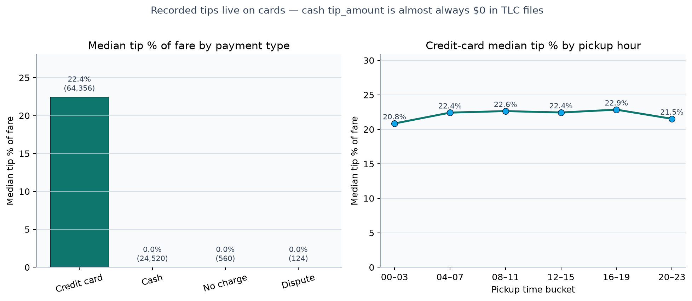
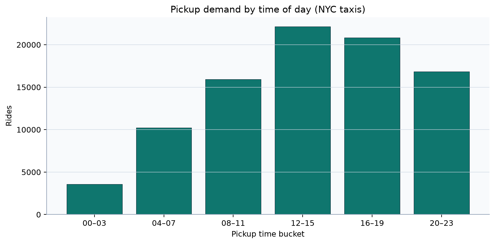
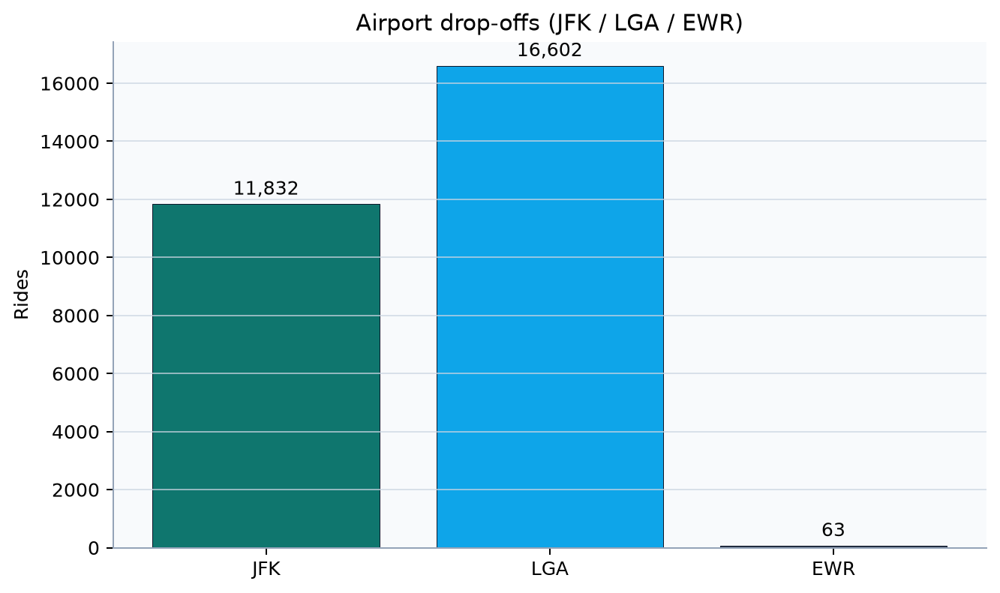
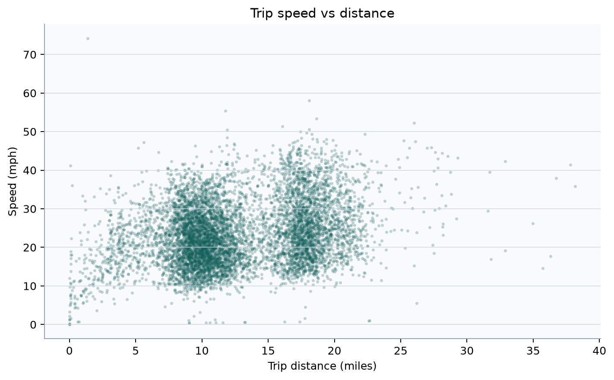
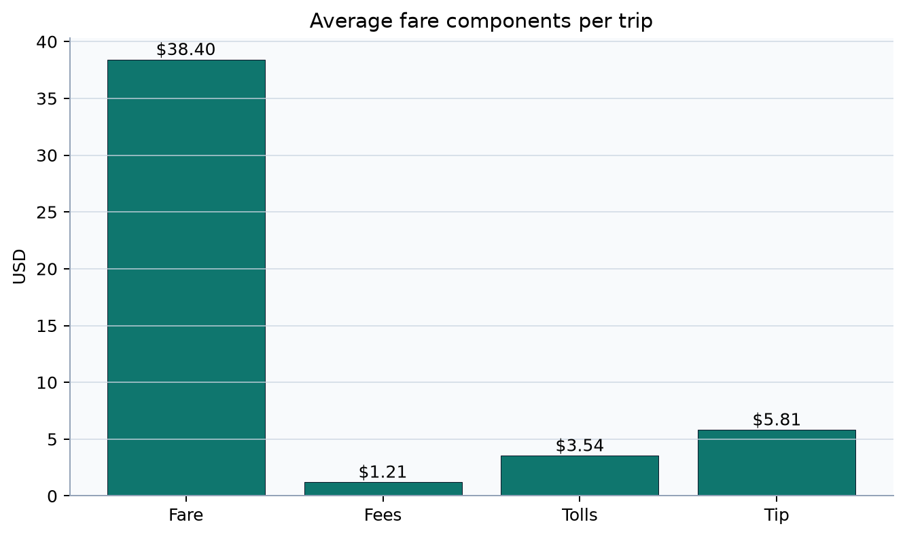

# NYC Taxi Rides — Explorer & Fare Calculator

[](https://huggingface.co/spaces/waleedarif1011/taxi-rides)
[](https://github.com/waleedarif1011/taxi_rides/actions/workflows/ci.yml)
[](LICENSE)

Interactive **exploratory analytics** and a lightweight **trip fare / tip estimator** on ~89k NYC taxi trips (Jan–Jun 2016 sample).

> **Honest positioning:** this is a portfolio EDA + demo Space — not a production ML pricing or dispatch product. After the Hugging Face Space is created (see [Deploy](#deploy-hugging-face-space)), open the badge URL above. Until then, run locally with `python app.py`.

## Sharper insight — tip rate by payment & hour

Cash trips in TLC files almost never show a tip (electronic `tip_amount` ≈ $0). Credit-card trips land near a **~22% median tip of fare**, and that rate stays flat across pickup-hour buckets once you filter to cards only.



## Key findings

| KPI | Value |
|-----|-------|
| Mean trip speed | **32.24 mph** |
| February rides | **13,333** |
| Tips greater than $50 | **16** |
| Airport drop-offs (JFK + LGA + EWR) | **28,497** (JFK 11,832 · LGA 16,602 · EWR 63) |
| Credit-card median tip % of fare | **~22%** (cash recorded tip ≈ 0%) |









## Quickstart

```bash
python -m pip install -r requirements.txt
python -m src.fare_model            # train + write artifacts/
python scripts/generate_figures.py  # export assets/*.png
python app.py                       # Gradio demo at http://127.0.0.1:7860
python -m pytest -q
```

## Interactive demo

`app.py` ships two tabs:

1. **KPI Explorer** — filter by month, time of day, and airport drop-off; see ride volume, average speed, tip %, and hourly demand.
2. **Fare & Tip Calculator** — enter distance, pickup hour, zones, and duration to estimate total fare and typical tip (HistGradientBoosting / Ridge multi-output regressor).

## Method (short)

- **Data:** `data/nyc_taxis.csv` (~89,560 trips) with pickup calendar fields, location codes, distance, duration, fare components, and tip.
- **Analytics:** vectorized NumPy/pandas KPIs in `src/analytics.py` (mean speed, February volume, high tips, airport breakdown, hourly/monthly demand, tip rate by payment type / hour).
- **Estimator:** `src/fare_model.py` trains Ridge and HistGradientBoosting multi-output models on pickup hour / day / month, location codes, distance, and duration to predict `total_amount` + `tip_amount`. Metrics land in `artifacts/metrics.json`.
- **Notebook:** original walkthrough preserved at [`notebooks/CabsDataAnalysis.ipynb`](notebooks/CabsDataAnalysis.ipynb) (path helper prefers `data/nyc_taxis.csv`).

## Tests & CI

```bash
python -m pytest -q
```

GitHub Actions runs figure generation + the same suite on every push/PR (`.github/workflows/ci.yml`).

## Deploy (Hugging Face Space)

This repo is Space-ready (`app.py` + Gradio README frontmatter). Create and push:

```bash
# once: huggingface-cli login   # needs a write token with Spaces scope
huggingface-cli repo create taxi-rides --type space --space_sdk gradio -y
git remote add space https://huggingface.co/spaces/waleedarif1011/taxi-rides
git push space HEAD:main
```

Or follow the checklist in [`docs/hf-space-deploy.md`](docs/hf-space-deploy.md).

## Layout

```
app.py                 Gradio NYC Taxi Explorer & Fare Calculator
src/analytics.py       KPI helpers + filters
src/fare_model.py      train / load / predict fare + tip
src/paths.py           data path resolution (data/ or legacy root)
data/nyc_taxis.csv     trip sample (~5MB)
artifacts/             fare_model.joblib + metrics.json
assets/                exported KPI charts (incl. tip_rate_insight.png)
notebooks/             original CabsDataAnalysis.ipynb
scripts/generate_figures.py
tests/                 pytest KPI + model sanity suite
docs/hf-space-deploy.md
```

## License

MIT — see [`LICENSE`](LICENSE).
